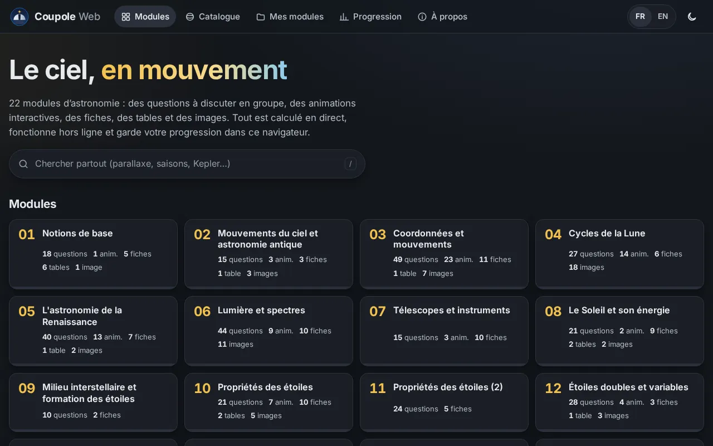
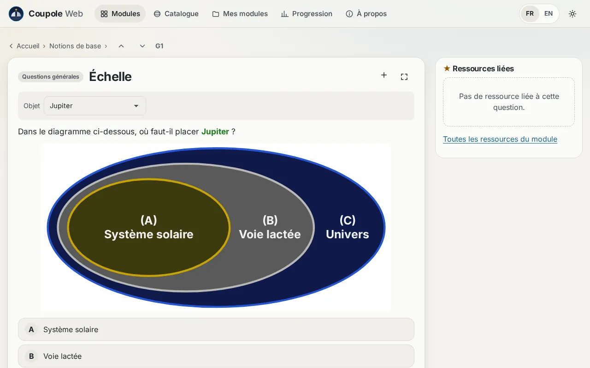
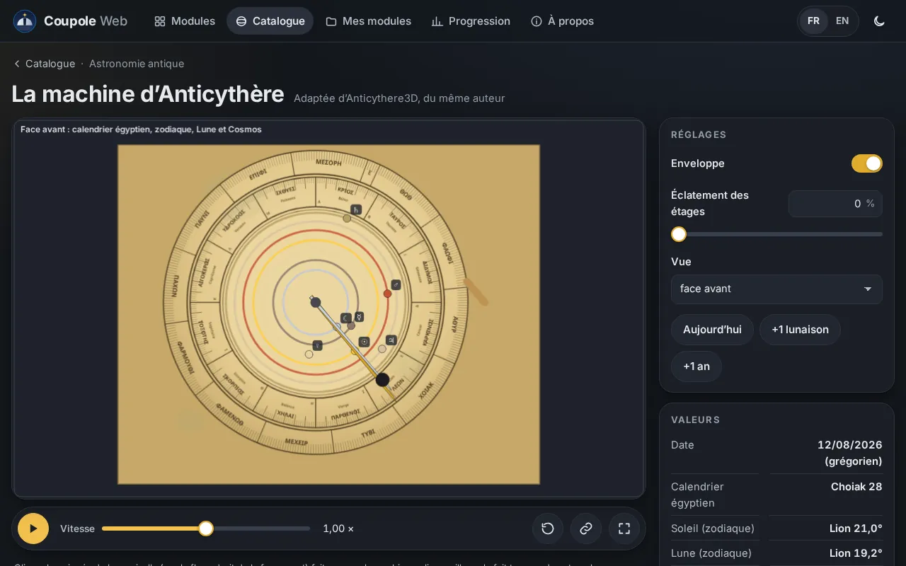
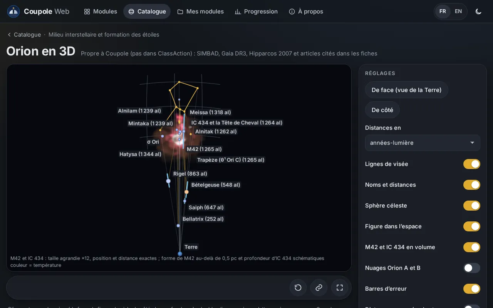
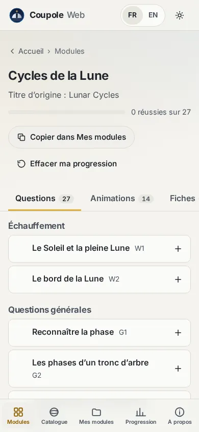

# Coupole Web

[](https://github.com/ARP273-ROSE/coupole-web/actions/workflows/ci.yml)
[](https://github.com/ARP273-ROSE/coupole-web/actions/workflows/pages.yml)
[](LICENSE)

**→ https://arp273-rose.github.io/coupole-web/**

*Français — [English below](#english)*

<p>
  
  
  
  
</p>
<p align="center"></p>

**22 modules d’astronomie** comme dans ClassAction : **517 questions** à discuter en groupe (variantes, figures,
réponse qui clignote, indice, explication, ressources liées ★), **94 animations**, **110 fiches**, **14 tables** et des
images libres (crédit et licence affichés), une **recherche** FR/EN dans tout, **Mes modules** (vos propres séquences)
et **Ma progression** ; tout est gardé dans le navigateur et s’exporte dans un fichier que lit aussi Coupole.

Les animations d’astronomie de [Coupole](https://github.com/ARP273-ROSE/coupole), dans le navigateur : sphère
céleste, repères, mouvements du Soleil, saisons, phases et éclipses de la Lune, orbites de Kepler et de Ptolémée,
distances des étoiles, lumière et spectres, exoplanètes, étoiles doubles… Refaites d’après **ClassAction**
(University of Nebraska-Lincoln Astronomy Education, licence Apache 2.0), avec **les mêmes formules, les mêmes données,
les mêmes réglages et les mêmes textes** que l’application de bureau Coupole. Les **92 animations** sont disponibles, plus
deux : la **machine d’Anticythère en 3D** (manivelle au doigt ou à la souris, cadrans gravés en grec, machine ouverte ou
éclatée, rapports exacts des engrenages), adaptée d’[Anticythere3D](https://github.com/ARP273-ROSE/Anticythere3D), du
même auteur, et **Orion en 3D** (comme la Grande Ourse 3D : les étoiles principales à leurs vraies distances, la figure sur la
sphère céleste, M42 et la Tête de Cheval en volume à leur place). Les spectres stellaires sont calculés
(Saha–Boltzmann sur des atmosphères modèles, 133 raies NIST, bandes moléculaires) ; les étoiles réelles ont leur
couleur vraie et une **fiche au survol** (souris, doigt ou clavier : type, magnitudes, distance avec son incertitude,
température, sources).

- **Typographie soignée** : unités SI (km·s⁻¹, W·m⁻²), signe moins, espaces fines, formules à délimiteurs extensibles.

- **Partout** : Chrome, Safari, Firefox, Edge ; ordinateur, tablette, téléphone ; de 320 px au 4K, portrait ou
  paysage.
- **Fluide** : dessin sur Canvas 2D net sur les écrans haute densité, seulement quand quelque chose bouge ; en pause
  quand l’onglet est caché ; chaque animation chargée à la demande.
- **Tactile et clavier** : glisser (tourner une sphère, déplacer un astre), pincer ou molette pour zoomer, appui long
  pour le clic droit ; flèches, `+`, `−`, `0`, espace.
- **Accessible** : libellés et aides lus par les lecteurs d’écran, focus visible, contrastes AA, mouvement réduit
  respecté ; vérifié par axe-core (WCAG 2.2 AA) sur chaque type de page, dans les deux thèmes.
- **Léger** : première page de 103 Ko compressés ; Lighthouse 95 à 100 en performances (mobile et bureau), 100 en
  accessibilité, bonnes pratiques et référencement.
- **Bilingue** : français et anglais (langue du navigateur détectée, bascule en un clic) ; thème sombre doux par
  défaut, clair ou automatique.
- **Partageable** : l’adresse de la page garde l’animation et ses réglages ; les réglages sont aussi mémorisés dans le
  navigateur.
- **Hors ligne et installable** (application web progressive) ; mise à jour proposée quand une nouvelle version est
  publiée.
- **Sûr et discret** : site entièrement statique, aucune requête vers un autre site, aucun traceur, aucun cookie ;
  politique de sécurité du contenu stricte (aucun script ni style en ligne), empreintes d’intégrité.

## Fidélité à l’application de bureau

Les calculs (temps sidéral IAU 1982, obliquité IAU 2006, Soleil et équation du temps de Meeus, Kepler, phases de la
Lune, précession, marées, Planck, Wien, hydrogène, Doppler, vitesses radiales, transits, barycentre…) sont transposés
du Python de Coupole. Deux jeux de références, produits par l’application de bureau elle-même, les vérifient :

- `tests/references/calculs.json` : plus de 4 000 appels de fonctions (et des arrondis de Python), que les tests
  TypeScript doivent retrouver à 10⁻⁹ près (relatif) ;
- `tests/references/animations.json` : pour chacune des 94 animations, ses réglages (bornes, défauts, décimales,
  unités, libellés, options) et les valeurs qu’elle affiche, au caractère près, en français et en anglais, dans un
  scénario fixe (création, pas d’animation, changement de tous les réglages, réinitialisation).

Les scripts `outils/exporter_coupole.py`, `outils/references_calculs.py` et `outils/references_animations.py`
régénèrent textes, données et références à partir d’un dépôt de Coupole.

## Développer

```sh
npm ci
npm run dev          # serveur de développement
npm test             # tests unitaires (Vitest) : calculs, animations, contenus
python3 -m pytest tests/test_confidentialite.py   # garde-fou de confidentialité (empreintes salées)
npm run build        # site statique dans dist/
python3 outils/importer_contenu.py DOSSIER   # contenus des modules (questions, fiches, tables, images) → public/contenu/
node outils/budget.mjs   # budget : première page < 150 Ko compressés, une animation par fichier
npm run test:e2e     # bout en bout (Playwright) : Chromium, Firefox, WebKit × téléphone, tablette, bureau
```

Pile : Vite, TypeScript strict, Canvas 2D, aucun cadriciel ; six dépendances de développement (Vite, Vitest,
TypeScript, Playwright, axe-core, types de Node), aucune à l’exécution.

## Licence et crédits

Licence Apache 2.0 (`LICENSE`). D’après ClassAction, University of Nebraska-Lincoln Astronomy Education (Apache 2.0) ;
machine d’Anticythère adaptée d’Anticythere3D (même auteur), d’après Freeth et al. (Nature 2006, 2008 ; Scientific
Reports 2021) ; Orion en 3D : SIMBAD (CDS), Gaia DR3 (ESA/DPAC), Hipparcos 2007, articles cités ; questions d’après
ClassAction (Apache 2.0), fiches, tables et schémas écrits pour Coupole, photographies libres (crédits exacts) ; données et sources citées dans `NOTICE`. Polices Inter et STIX Two Math (SIL Open Font License 1.1) ; côtes Natural Earth (domaine public).

---

## English

*Screenshots: see above (home, a question, the Antikythera Mechanism, Orion in 3D, a module on a phone).*

**22 astronomy modules** as in ClassAction: **517 questions** to discuss in groups (variants, figures, flashing
answer, hint, explanation, related resources ★), **94 animations**, **110 outlines**, **14 tables** and free images
(credit and licence shown), a FR/EN **search** across everything, **My modules** (your own sequences) and **My
progress**; everything is kept in the browser and exports to a file that Coupole also reads.

The astronomy animations of [Coupole](https://github.com/ARP273-ROSE/coupole), in the browser: celestial sphere,
coordinate systems, motions of the Sun, seasons, lunar phases and eclipses, Kepler’s and Ptolemy’s orbits, stellar
distances, light and spectra, exoplanets, binary stars… Remade after **ClassAction** (University of Nebraska-Lincoln
Astronomy Education, Apache 2.0 license), with **the same formulas, the same data, the same settings and the same
texts** as the Coupole desktop application. All **92 animations** are available, plus two: the **Antikythera
Mechanism in 3D** (crank turned with a finger or the mouse, dials engraved in Greek, open or exploded machine, exact
gear ratios), adapted from [Anticythere3D](https://github.com/ARP273-ROSE/Anticythere3D), by the same author, and
**Orion in 3D** (like the Big Dipper 3D: the main stars at their true distances, the figure on the celestial sphere,
M42 and the Horsehead in volume, in place). Stellar spectra are computed (Saha–Boltzmann on model atmospheres,
133 NIST lines, molecular bands); real stars have their true colour and a **hover data sheet** (mouse, finger or
keyboard: type, magnitudes, distance with its uncertainty, temperature, sources).

- **Careful typography**: SI units (km·s⁻¹, W·m⁻²), minus sign, thin spaces, formulas with stretchy delimiters.

- **Everywhere**: Chrome, Safari, Firefox, Edge; desktop, tablet, phone; from 320 px to 4K, portrait or landscape.
- **Smooth**: Canvas 2D drawing, sharp on high-density screens, only when something moves; paused when the tab is
  hidden; each animation loaded on demand.
- **Touch and keyboard**: drag (rotate a sphere, move a body), pinch or wheel to zoom, long press for right click;
  arrows, `+`, `−`, `0`, space.
- **Accessible**: labels and help read by screen readers, visible focus, AA contrast, reduced motion honoured;
  checked with axe-core (WCAG 2.2 AA) on every page type, in both themes.
- **Light**: 103 kB compressed first page; Lighthouse 95–100 for performance (mobile and desktop), 100 for
  accessibility, best practices and SEO.
- **Bilingual**: French and English (browser language detected, one-click switch); soft dark theme by default, light
  or automatic.
- **Shareable**: the page address keeps the animation and its settings; settings are also remembered in the browser.
- **Offline and installable** (progressive web app); update offered when a new version is published.
- **Safe and private**: fully static site, no request to any other site, no tracker, no cookie; strict content
  security policy (no inline script or style), subresource integrity.

## Faithful to the desktop application

The computations are transposed from Coupole’s Python. Two reference sets, produced by the desktop application
itself, check them: `tests/references/calculs.json` (more than 4,000 function calls, matched to 10⁻⁹ relative) and
`tests/references/animations.json` (for each of the 94 animations, its settings and the values it displays, character
for character, in French and English, through a fixed scenario).

## Develop

```sh
npm ci && npm run dev    # development server
npm test                 # unit tests (Vitest)
npm run build            # static site in dist/
npm run test:e2e         # end-to-end (Playwright): Chromium, Firefox, WebKit × phone, tablet, desktop
```

Stack: Vite, strict TypeScript, Canvas 2D, no framework; six development dependencies (Vite, Vitest, TypeScript,
Playwright, axe-core, Node types), none at run time.

## License and credits

Apache License 2.0 (`LICENSE`). After ClassAction, University of Nebraska-Lincoln Astronomy Education (Apache 2.0);
Antikythera Mechanism adapted from Anticythere3D (same author), after Freeth et al. (Nature 2006, 2008; Scientific
Reports 2021); Orion in 3D: SIMBAD (CDS), Gaia DR3 (ESA/DPAC), Hipparcos 2007, cited papers; questions after
ClassAction (Apache 2.0), outlines, tables and diagrams written for Coupole, free photographs (exact credits);
data and sources cited in `NOTICE`. Inter and STIX Two Math fonts (SIL Open Font License 1.1); Natural Earth coastlines (public domain).
